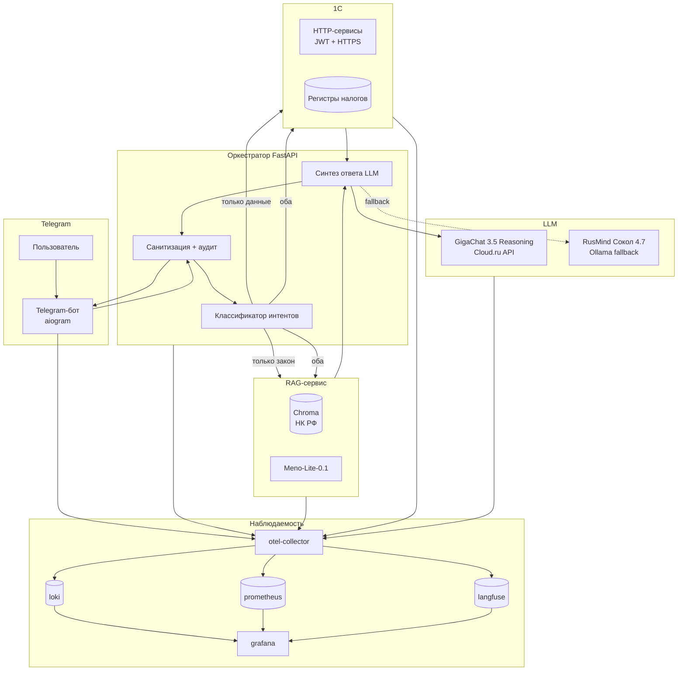

# AI-ассистент по налоговым вопросам

> **OpenSpec v1.x + Threat Modeling (STRIDE + OWASP LLM) + Observability by Design**

Telegram-бот с RAG по НК РФ и интеграцией с 1С: отвечает на налоговые вопросы с обязательным цитированием статей и фактическими данными (сальдо ЕНС, начисления, документы). Российская LLM (GigaChat 3.5 Reasoning + Meno-Lite + RusMind fallback).

---

## 📋 Содержание

- [Быстрый старт](#-быстрый-старт)
- [Структура проекта](#-структура-проекта)
- [Артефакты OpenSpec](#-артефакты-openspec)
- [Архитектура](#-архитектура)
- [Стек](#-стек)
- [Threat Model](#-threat-model)
- [Observability](#-observability)
- [Definition of Done](#-definition-of-done)
- [Лицензия](#-лицензия)

---

## 🚀 Быстрый старт

### 1. Клонировать репозиторий

```bash
git clone <repo-url> ai-tax-assistant
cd ai-tax-assistant
```

### 2. Проверить артефакты

Все артефакты OpenSpec находятся в `openspec/changes/tax-assistant/`. Точка входа — [`context.md`](context.md) (Traceability Matrix + DoD).

### 3. Развернуть компоненты

- 1С: [`deploy/1c-setup.md`](deploy/1c-setup.md)
- RAG: [`deploy/rag-setup.md`](deploy/rag-setup.md)
- Orchestrator + бот: [`deploy/bot-setup.md`](deploy/bot-setup.md)
- Observability: [`deploy/observability-setup.md`](deploy/observability-setup.md)
- Security: [`deploy/security.md`](deploy/security.md)

---

## 📁 Структура проекта

```
ai-tax-assistant/
├── README.md                          # этот файл
├── context.md                         # FINAL: Traceability Matrix + DoD
├── .gitignore
│
├── openspec/                          # OpenSpec-артефакты
│   ├── changes/tax-assistant/
│   │   ├── proposal.md                # Why / What Changes / Impact / Operability Promise
│   │   ├── spec.md                    # FR-001…006, NFR-001…006, NFR-SEC-001…006, NFR-OBS-001…005
│   │   ├── design.md                  # Архитектура, точки инструментирования, корреляция
│   │   ├── threat-model.md            # STRIDE + OWASP LLM, TM-01…TM-10, TB-01…TB-07
│   │   ├── tasks.md                   # T-001…T-506 (41 задача, 6 фаз)
│   │   ├── apply.md                   # M-001…M-007, feature flags, canary, rollback
│   │   ├── api-contract.yaml          # OpenAPI 3.1.0 (3 endpoint)
│   │   ├── adr/
│   │   │   ├── ADR-001-llm-provider.md
│   │   │   ├── ADR-002-rag-citation.md
│   │   │   ├── ADR-003-whitelist-1c-user.md
│   │   │   ├── ADR-004-audit.md
│   │   │   ├── ADR-005-1c-http-jwt.md
│   │   │   └── ADR-006-redaction-otel.md
│   │   └── test-specs/tax-assistant/
│   │       └── tests.md               # TC-001…TC-026 + TC-OBS-001…006
│   └── specs/tax-assistant/
│       └── spec.md                    # capability spec (копия для OpenSpec)
│
├── src/                               # 1С: исходники
│   ├── catalogs/                      # Taxes.xml, Periods.xml
│   ├── documents/                     # TaxAccrual.xml, TaxPayment.xml
│   ├── http/                          # TaxBalance.xml, TaxCalculate.xml, DocumentSearch.xml
│   ├── data/                          # demo.xml
│   └── reports/
├── config_src/AccumulationRegisters/
│   └── TaxBalance.xml
│
├── rag/                               # RAG-сервис (Python)
│   ├── data/nk_rf.json
│   ├── tests/test_search.py
│   ├── embedder.py                    # Meno-Lite-0.1
│   ├── vector_store.py                # Chroma
│   ├── search.py
│   └── requirements.txt
│
├── orchestrator/                      # FastAPI + классификатор + синтез
│   ├── classifier.py
│   ├── synthesizer.py
│   ├── fallback.py                    # RusMind Сокол 4.7
│   ├── sources.py                     # 1С API + RAG
│   ├── security.py                    # санитизация + redaction
│   ├── audit.py
│   ├── telemetry.py                   # OTel SDK
│   ├── spans.py                       # ручные спаны
│   ├── middleware.py
│   ├── main.py
│   └── requirements.txt
│
├── bot/                               # Telegram-бот (aiogram)
│   ├── main.py
│   ├── handlers.py
│   ├── security.py                    # whitelist + hashed ID
│   ├── rate_limit.py
│   ├── metrics.py
│   └── requirements.txt
│
├── tests/
│   ├── integration/test_e2e.py
│   ├── security/
│   │   ├── test_prompt_injection.py
│   │   └── test_audit_rotation.py
│   ├── nfr/test_llm_provider.py
│   ├── observability/test_obs.py
│   └── functional/
│
├── deploy/
│   ├── 1c-setup.md
│   ├── load-config.md
│   ├── load-demo-data.md
│   ├── rag-setup.md
│   ├── bot-setup.md
│   ├── observability-setup.md
│   ├── security.md
│   ├── otel-config.yaml
│   ├── otel-redaction.yaml
│   ├── grafana-dashboard.json
│   └── grafana-alerts.yaml
│
├── docs/
│   ├── demo.md                        # сценарий демо
│   ├── slides.md                      # слайды защиты
│   ├── qa.md                          # ответы на вопросы жюри
│   └── owasp-llm.md                   # OWASP LLM Top 10 чеклист
│
├── scripts/                           # PowerShell-скрипты генерации артефактов
│   ├── 00-New-Structure.ps1
│   ├── 01-Write-Proposal.ps1
│   ├── 02a-Write-Spec.ps1
│   ├── 02b-Write-Spec-Observability.ps1
│   ├── 03-Write-Design.ps1
│   ├── 04-Write-ThreatModel.ps1
│   ├── 05-Write-ADR.ps1
│   ├── 06-Write-ApiContract.ps1
│   ├── 07a-Write-Tests-FunctionalSecurity.ps1
│   ├── 07b-Write-Tests-Observability.ps1
│   ├── 08-Write-Tasks.ps1
│   ├── 09-Write-Apply.ps1
│   ├── 10-Write-Context.ps1
│   ├── 11-Write-Readme.ps1
│   └── 12-Run-All.ps1
│
└── backup/                            # вне git (см. .gitignore)
    └── .gitkeep
```

---

## 📚 Артефакты OpenSpec

| # | Артефакт | Что содержит | Ключевые ID |
|---|---|---|---|
| 1 | [`proposal.md`](openspec/changes/tax-assistant/proposal.md) | Why / What Changes / Impact / Operability Promise | — |
| 2 | [`spec.md`](openspec/changes/tax-assistant/spec.md) | Требования + Observability Contract + SLO | FR-001…006, NFR-001…006, NFR-SEC-001…006, NFR-OBS-001…005 |
| 3 | [`design.md`](openspec/changes/tax-assistant/design.md) | Архитектура, потоки данных, точки инструментирования, корреляция | — |
| 4 | [`threat-model.md`](openspec/changes/tax-assistant/threat-model.md) | STRIDE + OWASP LLM, активы, Trust Boundaries, матрица угроз | TM-01…TM-10, TB-01…TB-07 |
| 5 | [`adr/`](openspec/changes/tax-assistant/adr/) | 6 архитектурных решений с обоснованием | ADR-001…ADR-006 |
| 6 | [`api-contract.yaml`](openspec/changes/tax-assistant/api-contract.yaml) | OpenAPI 3.1.0, 3 endpoint, traceparent + trace_id | — |
| 7 | [`tests.md`](openspec/changes/tax-assistant/test-specs/tax-assistant/tests.md) | 32 теста (функциональные + security + observability) | TC-001…TC-026, TC-OBS-001…006 |
| 8 | [`tasks.md`](openspec/changes/tax-assistant/tasks.md) | 41 задача в 6 фазах | T-001…T-506 |
| 9 | [`apply.md`](openspec/changes/tax-assistant/apply.md) | Миграции, feature flags, canary, observability verification, rollback | M-001…M-007 |
| 10 | [`context.md`](context.md) | FINAL: Traceability Matrix + DoD | — |

---

## 🏗 Архитектура



**Контур:** вопрос → классификация → RAG + 1С → синтез → ответ с цитированием.

---

## 🧰 Стек

| Слой | Технология | Обоснование |
|---|---|---|
| 1С | 1С:Предприятие 8.3 (учебная / Комьюнити) | HTTP-сервисы для данных |
| RAG | Python + LangChain + Chroma | Open-source, гибкость (ADR-002) |
| Эмбеддинги | Meno-Lite-0.1 (НГУ) | Специализация на RAG (ADR-001) |
| LLM (основная) | GigaChat 3.5 Reasoning (Сбер) | Лучший балл среди российских моделей (ADR-001) |
| LLM (fallback) | RusMind Сокол 4.7 (DICPlay) | Открытые веса, offline (ADR-001) |
| Telegram | aiogram | Асинхронность |
| Оркестрация | FastAPI | Единый сервис |
| Logs | loki | Self-hosted, интеграция с grafana |
| Metrics | prometheus | Стандарт |
| Traces | langfuse | Специализация на LLM-трейсах |
| Collector | otel-collector | Стандарт OpenTelemetry |
| Visualization | grafana | Единая точка |

---

## 🛡 Threat Model

**Методология:** STRIDE + OWASP Top 10 for LLM (гибридная, обосновано в [`threat-model.md`](openspec/changes/tax-assistant/threat-model.md)).

### Top-угрозы (Risk = L × I, max 25)

| ID | Угроза | Risk | Контроль |
|---|---|---|---|
| TM-03 | Elevation of Privilege (подмена Telegram ID) | **20** | Whitelist + привязка к 1С (ADR-003) |
| TM-04 | Prompt Injection (LLM01) | **20** | Санитизация + системный промпт (NFR-SEC-002) |
| TM-06 | Sensitive Info Disclosure (LLM06) | **20** | Whitelist + redaction (ADR-003, ADR-006) |
| TM-07 | Misinformation / галлюцинация (LLM09) | **20** | RAG с обязательным цитированием (ADR-002) |
| TM-01 | Tampering (искажение данных в 1С) | **15** | JWT + только чтение (ADR-005) |
| TM-09 | PII in telemetry | **16** | Redaction processor (ADR-006) |
| TM-08 | DoS (флуд запросами) | **12** | Rate limiting (NFR-SEC-005) |
| TM-02 | Repudiation | **9** | Аудит (ADR-004) |
| TM-05 | Insecure Output (LLM02) | **9** | Citation validation (ADR-002) |
| TM-10 | Подмена LLM-провайдера | **8** | Валидация провайдера (NFR-006) |

### Trust Boundaries (7)

TB-01 (Telegram→бот), TB-02 (бот→оркестратор), TB-03 (оркестратор→LLM), TB-04 (оркестратор→1С), TB-05 (RAG→LLM), TB-06 (1С→оркестратор), TB-07 (телеметрия→бэкенды).

---

## 📊 Observability

**Инвариант:** OBS-C-01…06 (required).

### SLO

| SLO | Целевое значение | Сигнал |
|---|---|---|
| Latency p95 | ≤ 10 000 ms | `http.server.request.duration` p95 |
| Availability | ≥ 99% | `http.server.requests{status_code=5xx}` |
| Error rate | ≤ 1% | `http.server.requests{status_code=5xx}` / total |
| RAG precision | ≥ 90% | офлайн на эталонном наборе |
| Citation presence | ≥ 95% | `answer.citation.present.total{present="true"}` |

### 23 сигнала (Observability Contract)

- **Metrics (6):** `http.server.request.duration`, `telegram.messages.total`, `rag.search.duration`, `1c.api.duration`, `llm.request.duration`, `answer.citation.present.total`
- **Traces (6):** `telegram.message`, `orchestrator.classify`, `rag.search`, `1c.api.call`, `llm.synthesize`, `answer.send`
- **Logs (9):** `telegram.request.received`, `orchestrator.classified`, `rag.search.completed`, `1c.api.called`, `llm.request.completed`, `answer.sent`, `security.pii.redacted`, `security.blocked`, `audit.entry`
- **Business signals (2):** `tax.question.answered`, `1c.data.freshness`

### Корреляция (OBS-C-02)

W3C `traceparent` пробрасывается: Telegram-бот → Orchestrator → RAG / 1С → LLM (включая async). `trace_id` в каждом логе и в `ErrorResponse`.

### Redaction (OBS-C-04)

Hashed ID в приложении + regex-редактирование в otel-collector (ADR-006). 0 PII в бэкендах.

---

## ✅ Definition of Done

- [x] Все FR покрыты ≥1 Task и ≥1 Test
- [x] Все NFR покрыты ≥1 Task, ≥1 Test и ≥1 Verify Method
- [x] Все NFR-SEC покрывают ≥1 TM-NNN и имеют Security-тест
- [x] Все TM-NNN имеют контроль и связанный NFR-SEC
- [x] Методология Threat Modeling обоснована
- [x] Trust Boundaries визуализированы с цветовой кодировкой
- [x] Нет ADR без связи с design.md или TM
- [x] Нет пустых обязательных ячеек в Traceability Matrix
- [x] Матрица Task → FR/NFR/TM полностью построена
- [x] `context.md` актуален
- [x] Все NFR-OBS покрыты ≥1 Task, ≥1 Observability-тест и ≥1 сигналом
- [x] Observability Contract заполнен (23 сигнала)
- [x] В `apply.md` есть Observability Verification checklist (25 чек-пунктов)
- [x] Корреляция (traceparent / X-Request-ID) в API Contract
- [x] Все сигналы с PII имеют redaction-контроль
- [x] OBS-C-01…06 выполнены
- [x] Каждый NFR-OBS ссылается на ≥1 OBS-C-NN
- [x] `observability_context.stack` заполнен до design
- [x] (gost_compliance: false) — ГОСТ-документы не требуются

---


