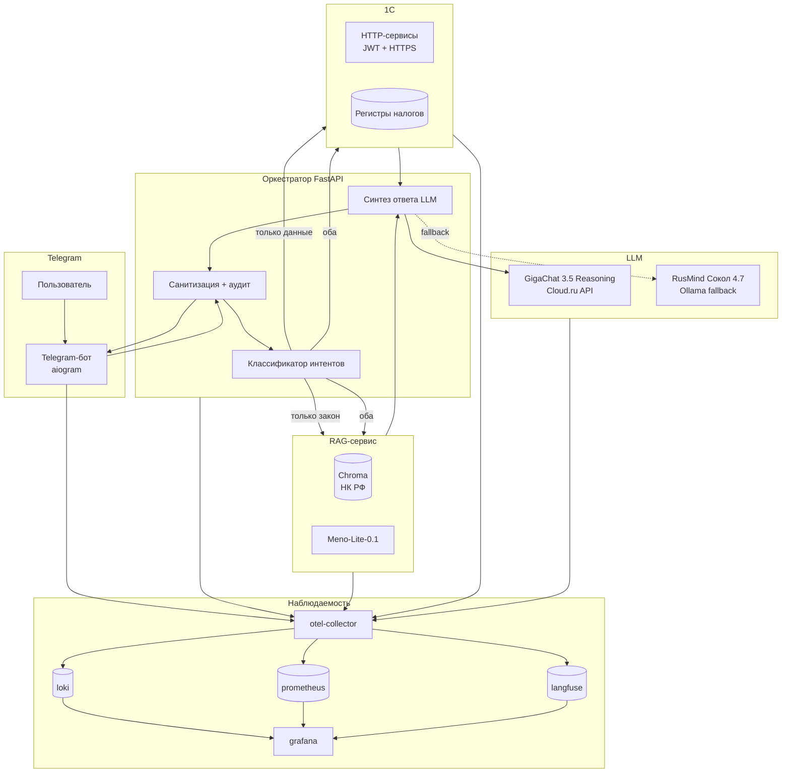
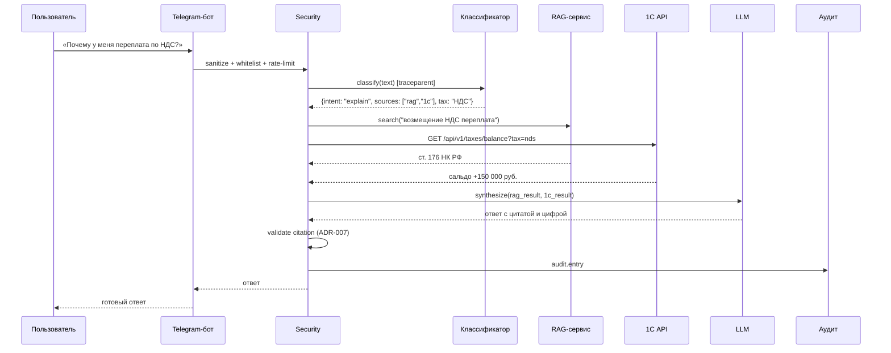
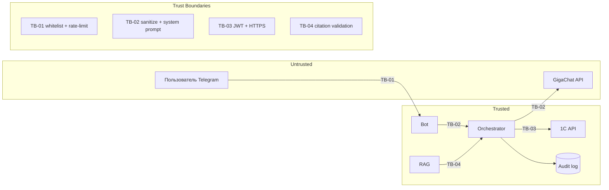

## Context

AI-ассистент по налоговым вопросам для малого/среднего бизнеса. Команда: 3 человека (1С-разработчик, Python-разработчик, бизнес-аналитик). Срок — окно финала. Ограничения: 1С:Предприятие 8.3 (учебная / Комьюнити-лицензия); LLM — российская (GigaChat 3.5 Reasoning + Meno-Lite + RusMind fallback); Telegram — единственный канал; стек наблюдаемости фиксирован (loki, prometheus, langfuse, otel-collector, grafana). Регуляторика: 152-ФЗ. Контур: вопрос → классификация → RAG + 1С → синтез → ответ с цитированием.

## Goals / Non-Goals

**Goals:**
- Гибридная архитектура: 1С (фактические данные) + RAG (НК РФ) + Telegram (интерфейс).
- Классификатор запросов с fallback на уточняющий вопрос.
- Ответы с обязательным цитированием НК РФ и указанием источника данных 1С.
- Защита от prompt injection и галлюцинаций (см. `threat-model.md`).
- Соответствие NFR-001…NFR-006, NFR-SEC-001…006, NFR-OBS-001…005.
- Полное покрытие наблюдаемости (OBS-C-01…06) в выбранном стеке.

**Non-Goals:**
- Замена бухгалтера или налогового консультанта (ассистент — только помощник).
- Автоматическая подача деклараций в ФНС.
- Поддержка всех налогов РФ в MVP (только НДС, налог на прибыль, УСН).
- Полная интеграция с 1С:Бухгалтерия (используем каркас `ai-grd` для демо).
- Распределение косвенных затрат, себестоимость всего предприятия.

## Decisions

### Компонентная архитектура

### Потоки данных

### Data Flow Diagram (для threat-model)

### Технологический стек

| Слой | Технология | Обоснование |
|---|---|---|
| 1С | 1С:Предприятие 8.3 (учебная / Комьюнити) | Каркас из `ai-grd`; HTTP-сервисы для данных |
| RAG | Python + LangChain/LlamaIndex + Chroma | Open-source, гибкость (ADR-002) |
| Эмбеддинги | Meno-Lite-0.1 (НГУ, российская) | Специально оптимизирована для RAG, Apache 2.0 (ADR-001) |
| LLM (основная) | GigaChat 3.5 Reasoning (Сбер, Cloud.ru API) | Наивысший балл среди российских моделей в MERA v2, режим рассуждений (ADR-001) |
| LLM (fallback) | RusMind Сокол 4.7 (DICPlay, Ollama) | Открытые веса, GGUF, работает офлайн (ADR-001) |
| Telegram | aiogram (Python) | Асинхронность, активное сообщество |
| Оркестрация | FastAPI (Python) | Единый сервис для классификатора и синтеза |
| **Observability (logs)** | **loki** | Лёгкий, self-hosted, интеграция с grafana |
| **Observability (metrics)** | **prometheus** | Стандарт, интеграция с grafana |
| **Observability (traces)** | **langfuse** | Специализация на LLM-трейсах (prompt/response/tokens) |
| **Observability (collector)** | **otel-collector** | Стандарт OpenTelemetry |
| **Observability (visualization)** | **grafana** | Единая точка для loki/prometheus/langfuse |

> Стек наблюдаемости взят из `observability_context.stack` (зафиксирован до `design`).

### Модель данных 1С (налоги)

| Объект | Тип | Ключевые реквизиты |
|---|---|---|
| Налоги | Справочник | Код, Наименование (НДС, Прибыль, УСН) |
| Периоды | Справочник | Год, Квартал/Месяц |
| Начисления налогов | Документ | Налог, Период, Сумма |
| Уплаты налогов | Документ | Налог, Дата, Сумма |
| Сальдо ЕНС | Регистр накопления | Налог, Период, Сумма (приход/расход) |
| Документы | Справочник | Тип (счёт-фактура, декларация), Номер, Дата |

### Логика классификации

1. **Rule-based фильтр** (быстрый): ключевые слова → intent.
2. **LLM-классификатор** (GigaChat function calling): выбор инструментов.
3. **Fallback**: confidence < 0.7 → уточняющий вопрос.

### Формат цитирования (ADR-002)

Номер статьи + пункт + краткая цитата (1–3 предложения). Пример: «Согласно ст. 164 п. 1 НК РФ, ставка НДС составляет 20%». Полный текст — по команде «подробнее».

### Точки инструментирования

> Заполнено на основе Observability Contract из `spec.md`. Колонка «Экспорт» — из `observability_context.stack`.

| Сигнал | Где создаётся (файл/класс/компонент) | Тип | Auto/Manual | Атрибуты | Экспорт |
|--------|--------------------------------------|-----|-------------|----------|---------|
| `http.server.request.duration` | `orchestrator/middleware.py` (FastAPI middleware) | metric | auto | `http.method`, `http.route`, `http.status_code`, `trace_id` | prometheus |
| `telegram.messages.total` | `bot/metrics.py` (aiogram middleware) | metric | manual | `chat.type`, `status`, `trace_id` | prometheus |
| `rag.search.duration` | `rag/search.py` (декоратор) | metric | manual | `top_k`, `result.count`, `trace_id` | prometheus |
| `1c.api.duration` | `orchestrator/sources.py` (httpx middleware) | metric | auto | `endpoint`, `status_code`, `trace_id` | prometheus |
| `llm.request.duration` | `orchestrator/synthesizer.py` (обёртка вызова) | metric | manual | `llm.model`, `llm.provider`, `trace_id` | prometheus |
| `answer.citation.present.total` | `orchestrator/synthesizer.py` (post-validation) | metric | manual | `present`, `tax.type`, `trace_id` | prometheus |
| `telegram.message` | `bot/handlers.py` | span | manual | `telegram.chat_id` (hashed), `trace_id` | langfuse |
| `orchestrator.classify` | `orchestrator/classifier.py` | span | manual | `intent`, `sources.selected`, `confidence`, `trace_id` | langfuse |
| `rag.search` | `rag/search.py` | span | manual | `query.length`, `top_k`, `result.count`, `trace_id` | langfuse |
| `1c.api.call` | `orchestrator/sources.py` | span | manual | `endpoint`, `status_code`, `duration_ms`, `trace_id` | langfuse |
| `llm.synthesize` | `orchestrator/synthesizer.py` | span | manual | `llm.model`, `tokens.in`, `tokens.out`, `citation.present`, `trace_id` | langfuse |
| `answer.send` | `bot/handlers.py` | span | manual | `chat_id` (hashed), `answer.length`, `trace_id` | langfuse |
| `telegram.request.received` | `bot/handlers.py` | log | manual | `user_id` (hashed), `chat_id` (hashed), `trace_id` | loki |
| `orchestrator.classified` | `orchestrator/classifier.py` | log | manual | `intent`, `sources`, `confidence`, `trace_id` | loki |
| `rag.search.completed` | `rag/search.py` | log | manual | `top_k`, `result.count`, `trace_id` | loki |
| `1c.api.called` | `orchestrator/sources.py` | log | manual | `endpoint`, `status_code`, `duration_ms`, `trace_id` | loki |
| `llm.request.completed` | `orchestrator/synthesizer.py` | log | manual | `llm.model`, `tokens.in`, `tokens.out`, `trace_id` | loki |
| `answer.sent` | `bot/handlers.py` | log | manual | `chat_id` (hashed), `citation.present`, `trace_id` | loki |
| `security.pii.redacted` | `orchestrator/security.py` (redaction processor) | log | manual | `field.name`, `trace_id` | loki |
| `security.blocked` | `orchestrator/security.py` | log | manual | `reason`, `user_id` (hashed), `trace_id` | loki |
| `audit.entry` | `orchestrator/audit.py` | log | manual | `user_id`, `sources`, `answer.length`, `trace_id` | loki |
| `tax.question.answered` | `orchestrator/synthesizer.py` (post-answer) | business | manual | `tax.type`, `sources.used`, `citation.present`, `trace_id` | prometheus |
| `1c.data.freshness` | `orchestrator/sources.py` (при вызове 1С) | business (gauge) | manual | `tax.type`, `as_of_date`, `trace_id` | prometheus |

### Проброс корреляции

- **W3C `traceparent`:** Telegram-бот (aiogram middleware) генерирует `traceparent` при получении сообщения → передаёт в HTTP-заголовке `traceparent` при вызове Orchestrator (FastAPI) → Orchestrator пробрасывает в RAG (внутренний вызов) и 1С API (httpx middleware) → в LLM (GigaChat API поддерживает `traceparent` в заголовке; для RusMind — через ollama-обёртку).
- **`X-Request-ID`:** опционально; используется как fallback, если `traceparent` не пробросился (например, async LLM-вызов через очередь).
- **Service A → Service B:** `traceparent` в HTTP-заголовке; Orchestrator → 1С API — JWT + `traceparent`.
- **Async (LLM-вызовы):** `traceparent` сохраняется в контексте задачи (contextvars в Python); при fallback на RusMind — передаётся через ollama-обёртку с `X-Request-ID`.
- **`trace_id` в `ErrorResponse`:** API Contract обязывает возвращать `trace_id` в каждом `ErrorResponse` (OBS-C-02).

## Risks / Trade-offs

- **Риск:** LLM галлюцинирует статью НК РФ → **Митигация:** RAG с обязательным цитированием (ADR-002); ответ без источника отклоняется.
- **Риск:** Prompt injection через Telegram → **Митигация:** санитизация ввода, системный промпт (TM-04).
- **Риск:** Утечка финансовых данных через Telegram → **Митигация:** whitelist + привязка к 1С-пользователю (ADR-003), аудит (ADR-004).
- **Риск:** GigaChat API недоступен → **Митигация:** fallback на RusMind Сокол 4.7 (ADR-001).
- **Риск:** PII в телеметрии → **Митигация:** redaction processor в otel-collector; `pii: true` + `security.pii.redacted` (NFR-OBS-004, OBS-C-04).
- **Trade-off:** RAG на open-source LLM vs. GigaChat → дешевле/приватнее, но качество ниже. Для MVP GigaChat — основной, RusMind — fallback.
- **Trade-off:** учебная 1С ограничивает одновременные сеансы → для пилота использовать Комьюнити-лицензию.
- **Trade-off:** langfuse хранит prompt/response → потенциальный PII; митигация: redaction до отправки в langfuse (в otel-collector).

## Migration Plan

1. Развернуть 1С (учебная / Комьюнити), создать базу `TaxAssistant`.
2. Создать справочники (Налоги, Периоды), документы (Начисление, Уплата), регистр (Сальдо ЕНС).
3. Реализовать HTTP-сервисы (`/taxes/balance`, `/taxes/calculate`, `/documents/search`) с JWT.
4. Развернуть RAG-сервис (Python + Chroma + Meno-Lite).
5. Развернуть оркестратор (FastAPI) + Telegram-бота (aiogram).
6. Развернуть стек наблюдаемости (otel-collector → loki / prometheus / langfuse → grafana).
7. Настроить whitelist и аудит.
8. Прогнать демо-сценарий, снять резервную копию.

## Open Questions

- [ ] Источник корпуса НК РФ: официальный текст vs. парсинг с гаранта?
- [ ] Срок хранения аудит-логов: 90 дней (ADR-004) — подтвердить.
- [ ] Нужен ли архив логов перед ротацией (администратор)?
