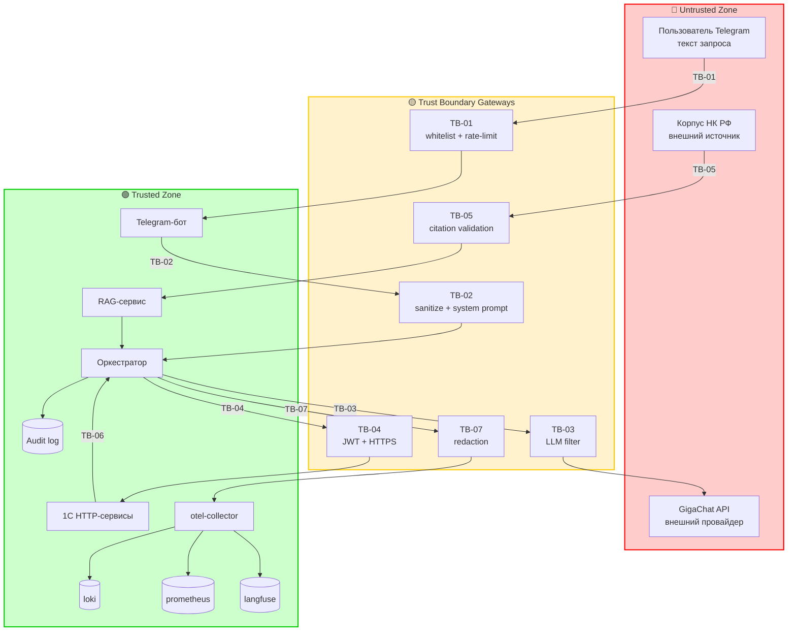

## 1. Выбор методологии

- **Выбрано:** STRIDE + OWASP Top 10 for LLM (комбинированная)
- **Обоснование:** `security_context = {"regulatory": ["152-ФЗ"], "ai": ["RAG", "LLM", "tool-calling"], "assets": ["financial_data", "PII", "secrets"]}`. Присутствуют LLM/AI-компоненты (RAG, tool-calling, промпты) **и** регуляторика 152-ФЗ **и** PII/финансовые данные. По правилу выбора: «Если `ai` непусто и присутствуют PII/регуляторика → STRIDE + OWASP LLM».
- **Отвергнутые альтернативы:**
  - **STRIDE baseline** — отклонена: не покрывает LLM-специфичные угрозы (prompt injection, галлюцинации).
  - **OWASP LLM alone** — отклонена: не покрывает классические угрозы (Tampering, Repudiation, Elevation) в 1С и Telegram.
  - **LINDDUN** — отклонена: PII есть, но приватность не единственное ключевое требование; LINDDUN дополняется STRIDE, но для MVP достаточно STRIDE + OWASP LLM.
  - **PASTA/OCTAVE** — отклонены: избыточны для MVP.
  - **MITRE ATT&CK** — отклонена: нет требования APT/adversarial-модели.
- **Скоуп:** Telegram-бот, слой оркестрации (FastAPI), RAG-сервис, 1С HTTP-сервисы, LLM-вызовы (GigaChat / RusMind), каналы передачи данных, телеметрия (loki/prometheus/langfuse). Не покрываются: инфраструктура 1С (ОС, сеть), резервное копирование, физическая безопасность.

## 2. Активы и классификация данных

| Актив | Класс данных | Компонент | Владелец |
|---|---|---|---|
| Финансовые показатели компании | financial (confidential) | 1С → Orchestrator → Telegram | Бухгалтер / Руководитель |
| Налоговые данные (сальдо, начисления) | financial (confidential) | 1С | Бухгалтер |
| Запросы пользователей | PII (internal) | Telegram → Orchestrator | Пользователь |
| Ответы ассистента | PII + financial (internal) | Orchestrator → Telegram | Пользователь |
| НК РФ (корпус) | public | RAG | — |
| Токены GigaChat API | secret | конфигурация | Администратор |
| JWT для 1С API | secret | Orchestrator ↔ 1С | Администратор |
| Телеметрия (logs/spans/metrics) | PII (potential) | otel-collector → loki/prometheus/langfuse | Администратор |

## 3. Границы доверия (Trust Boundaries)

| ID | Граница | Откуда → Куда | Контроль безопасности |
|----|---------|---------------|----------------------|
| TB-01 | Пользователь → Telegram-бот | Telegram → бот | Whitelist ID + rate limiting (NFR-SEC-001, NFR-SEC-005) |
| TB-02 | Бот → Оркестратор | бот → FastAPI | Валидация, санитизация (NFR-SEC-002) |
| TB-03 | Оркестратор → LLM (GigaChat) | orchestrator → GigaChat API | Системный промпт, фильтрация (NFR-SEC-002) |
| TB-04 | Оркестратор → 1С API | orchestrator → 1С | JWT, HTTPS, таймауты (NFR-SEC-006) |
| TB-05 | RAG → LLM | RAG → LLM | Валидация цитат (NFR-SEC-003) |
| TB-06 | 1С → Оркестратор | 1С → orchestrator | Только чтение, аудит (NFR-SEC-004) |
| TB-07 | Телеметрия → Бэкенды | otel-collector → loki/prometheus/langfuse | Redaction PII (NFR-OBS-004, OBS-C-04) |

## 4. Визуализация потоков данных (цветовая кодировка)

**Легенда:**
- 🟢 **Trusted** — компоненты под нашим контролем
- 🔴 **Untrusted** — внешние источники ввода
- 🟡 **Boundary / Gateway** — точки пересечения границ

## 5. Матрица угроз

> Колонки «Категория» и «ID» — комбинированные (STRIDE + OWASP LLM).
> **Risk Scoring:** Risk = Likelihood (1–5) × Impact (1–5). Max = 25.
> **Top-3** — угрозы с наивысшим Risk для immediate mitigation.

| ID | Категория | Угроза | Вектор | Актив | TB | L | I | Risk | Контроль | Requirement |
|----|-----------|--------|--------|-------|----|---|---|------|----------|-------------|
| TM-01 | T (Tampering) | Искажение финансовых данных в 1С | Ручной ввод / API | Финансовые данные | TB-04, TB-06 | 3 | 5 | **15** | Валидация, журнал 1С, JWT, только чтение | NFR-SEC-006 |
| TM-02 | R (Repudiation) | Отрицание запроса/ответа пользователем | Отсутствие аудита | Запросы/ответы | TB-06 | 3 | 3 | **9** | Аудит всех запросов/ответов (ADR-004) | NFR-SEC-004 |
| TM-03 | E (Elevation of Privilege) | Доступ к чужим данным через бота | Подмена Telegram ID | Финансовые данные | TB-01 | 4 | 5 | **20** | Whitelist + привязка к 1С-пользователю (ADR-003) | NFR-SEC-001 |
| TM-04 | **LLM01: Prompt Injection** | Вредоносный запрос заставляет LLM игнорировать инструкции | Текст запроса / RAG-документ | LLM, промпт | TB-02, TB-03, TB-05 | 5 | 4 | **20** | Санитизация, системный промпт, allowlist retrieved docs | NFR-SEC-002 |
| TM-05 | **LLM02: Insecure Output Handling** | LLM возвращает вредоносный код/ссылки | LLM output | Ответ пользователю | TB-03 | 3 | 3 | **9** | Валидация вывода, экранирование, citation validation | NFR-SEC-003 |
| TM-06 | **LLM06: Sensitive Information Disclosure** | Утечка финансовых данных / PII через ответ или телеметрию | LLM output / logs | PII + financial | TB-03, TB-07 | 4 | 5 | **20** | Whitelist, redaction в телеметрии, фильтрация ответа | NFR-SEC-001, NFR-OBS-004 |
| TM-07 | **LLM09: Misinformation** | Галлюцинация статьи НК РФ | LLM output | Ответ пользователю | TB-03, TB-05 | 5 | 4 | **20** | RAG с обязательным цитированием (ADR-002) | NFR-SEC-003 |
| TM-08 | D (Denial of Service) | Флуд запросами → отказ бота / превышение квоты GigaChat | Telegram-бот | Доступность | TB-01 | 4 | 3 | **12** | Rate limiting (NFR-SEC-005) | NFR-SEC-005 |
| TM-09 | I (Information Disclosure) | PII в телеметрии (logs/spans/metrics) без redaction | Телеметрия | PII | TB-07 | 4 | 4 | **16** | Redaction processor, `security.pii.redacted` audit | NFR-OBS-004 |
| TM-10 | S (Spoofing) | Подмена LLM-провайдера (не российская LLM) | Конфигурация | NFR-006 | — | 2 | 4 | **8** | Проверка провайдера (NFR-006), конфиг-валидация | NFR-006 |

### Top-3 для immediate mitigation

1. **TM-03 (Risk 20)** — Elevation of Privilege через подмену Telegram ID → NFR-SEC-001 (whitelist + привязка к 1С-пользователю), P0
2. **TM-04 (Risk 20)** — Prompt Injection → NFR-SEC-002 (санитизация + системный промпт + allowlist retrieved docs), P0
3. **TM-06 (Risk 20)** — Sensitive Information Disclosure (ответ + телеметрия) → NFR-SEC-001 + NFR-OBS-004 (whitelist + redaction), P0
4. **TM-07 (Risk 20)** — Misinformation (галлюцинация НК РФ) → NFR-SEC-003 (обязательное цитирование), P0

> Примечание: Top-3 по Risk содержит 4 угрозы с одинаковым Risk = 20. Все 4 — P0.

## 6. Требования безопасности (→ в spec.md и design.md)

| Requirement | Описание | Покрывает TM | Метрика / verify |
|-------------|----------|--------------|------------------|
| NFR-SEC-001 | Whitelist Telegram ID; неавторизованные отклоняются; привязка к 1С-пользователю | TM-03, TM-06 | 100% неавторизованных отклонены; тест TC-013 |
| NFR-SEC-002 | Санитизация ввода + системный промпт + allowlist retrieved docs | TM-04 | 100% prompt injection блокируются; тесты TC-016…TC-018 |
| NFR-SEC-003 | Обязательное цитирование НК РФ; ответ без источника не принимается | TM-05, TM-07 | 100% ответов содержат источник; тест TC-011, TC-020 |
| NFR-SEC-004 | Аудит всех запросов и ответов (кто, когда, что, источники) | TM-02 | 100% запросов в аудит-логе; тест TC-015 |
| NFR-SEC-005 | Rate limiting (≤ 10 запросов/мин на пользователя) | TM-08 | 0 успешных запросов сверх лимита; тест TC-014 |
| NFR-SEC-006 | HTTPS + JWT для 1С API; только чтение | TM-01 | 100% вызовов защищены; тест TC-023, TC-024 |
| NFR-OBS-004 | Redaction PII в телеметрии (logs/spans/metrics) | TM-06, TM-09 | 0 PII в бэкендах; тест TC-OBS-004 |
| NFR-006 | Проверка, что LLM — российская (GigaChat/Meno-Lite/RusMind) | TM-10 | 100% провайдеров ∈ allowlist; тест TC-026 |

## 7. Влияние на ADR

> Какие архитектурные решения должны быть приняты/пересмотрены по итогам TM. Служит входом для следующего шага `adr`.

- **ADR-кандидат 1 (TM-03, TM-06):** Whitelist + привязка к 1С-пользователю → ADR-003.
- **ADR-кандидат 2 (TM-04):** Санитизация + системный промпт + allowlist retrieved docs → реализуется в `orchestrator/security.py` (T-301, T-302), покрыт NFR-SEC-002 (без отдельного ADR).
- **ADR-кандидат 3 (TM-05, TM-07):** RAG с обязательным цитированием → ADR-002.
- **ADR-кандидат 4 (TM-02):** Аудит запросов/ответов → ADR-004.
- **ADR-кандидат 5 (TM-01):** HTTP-сервисы 1С с JWT → ADR-005.
- **ADR-кандидат 6 (TM-06, TM-09):** Redaction PII в телеметрии → ADR-006.
- **ADR-кандидат 7 (TM-10):** Проверка российского провайдера LLM → ADR-001 (расширение).
- **ADR-кандидат 8 (TM-06):** Хранение истории 90 дней → ADR-004.
- **ADR-кандидат 9 (общий):** Выбор векторной БД Chroma → ADR-002 (часть решения RAG).
